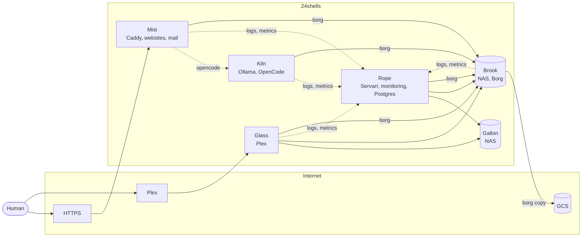

It has been a while since my [Postmortem & Homelab Updates](https://writing.natwelch.com/post/759) post, which itself followed [Homelab 2024](https://writing.natwelch.com/post/745). The biggest change is that none of it runs at home any more. All of the servers now live in colocation at [24shells](https://24shells.net). 

It's still mostly the same shape, but I'm running a lot more random stuff.

## Platform

- [Tailscale](https://github.com/tailscale/tailscale) on every host.
- Monitoring: [Grafana Alloy](https://github.com/grafana/alloy) on every host ships logs and metrics to [Loki](https://github.com/grafana/loki) and [Prometheus](https://github.com/prometheus/prometheus) on Rope, with [Grafana](https://github.com/grafana/grafana) and [Alertmanager](https://github.com/prometheus/alertmanager) on top. UptimeRobot watches the public sites.
- Backups: every host runs [Borg](https://github.com/borgbackup/borg) to Brook, and Brook copies the Borg repository to Google Cloud Storage daily.
- [Postgres](https://github.com/postgres/postgres) and [Redis](https://github.com/redis/redis) on Rope.
- A mail server ([docker-mailserver](https://github.com/docker-mailserver/docker-mailserver)) on Mist, plus [Parse DMARC](https://github.com/dmarcguardhq/parse-dmarc) for DMARC reports.
- [fail2ban](https://github.com/fail2ban/fail2ban) on Mist.
- [Maestral](https://github.com/samschott/maestral) on Brook to keep a copy of Dropbox.

## Media (Rope)

- [RomM](https://github.com/rommapp/romm) for game ROMs.
- [slskd](https://github.com/slskd/slskd) for Soulseek.
- [spotify-to-plex](https://github.com/jjdenhertog/spotify-to-plex) to sync playlists into Plex.
- [GYB](https://github.com/GAM-team/got-your-back) to back up Gmail.
- [harvestarr](https://github.com/icco/harvestarr) and [letterboxd-list-radarr](https://github.com/icco/letterboxd-list-radarr), two small tools for feeding the Servarr stack.
- [FlareSolverr](https://github.com/FlareSolverr/FlareSolverr) for Prowlarr.

## Websites and apps (Mist)

- Etu, a journaling app: [web](https://github.com/icco/etu-web) and [backend](https://github.com/icco/etu-backend) (plus sync and tag generation workers) at etu.timeclimbers.com.
- [timeclimbers.com](https://github.com/icco/timeclimbers.com) and its friends: [tristan](https://github.com/icco/commit), [hayden](https://github.com/icco/hayden), and [curriculum](https://github.com/icco/curriculum).
- [art](https://github.com/icco/art) and [artgrabber](https://github.com/icco/artgrabber).
- [cambridge](https://github.com/icco/cambridge), an analog world clock.
- [code](https://github.com/icco/code.natwelch.com), [images](https://github.com/icco/images), [videos](https://github.com/icco/videos), [linkbot](https://github.com/icco/linkbot), and [roderick](https://github.com/icco/roderick).
- [gotak](https://github.com/icco/gotak), [lilguys.love](https://github.com/icco/lilguys.love), and [robot.villas](https://github.com/icco/robot.villas).
- go.icco.me, which I wrote about in [Hosted Go Urls](https://writing.natwelch.com/post/780) ([config](https://github.com/icco/icco.me/blob/main/mist/docker-compose.yml)).
- [acntng](https://github.com/icco/acntng), my personal accounting tool.
- A Borg status page and a devcloud.org redirect, both just compose entries in [icco/icco.me](https://github.com/icco/icco.me/blob/main/mist/docker-compose.yml).

## AI

- [OpenCode](https://github.com/anomalyco/opencode) and [OpenChamber](https://github.com/openchamber/openchamber) on Mist, packaged as [opencode-server](https://github.com/icco/opencode-server), a hosted coding agent at opencode.natwelch.com.

## Kiln

Kiln is a new box with a Tesla P40. It will run [Ollama](https://github.com/ollama/ollama), and OpenCode and OpenChamber move to it from Mist. Mist's Caddy will keep serving opencode.natwelch.com and proxy it to Kiln. It gets the same Alloy, Borg, and cron setup as the other hosts, plus [nvidia_gpu_exporter](https://github.com/utkuozdemir/nvidia_gpu_exporter) so I can watch the P40 in Grafana.

Also upcoming is a [LiteLLM](https://github.com/BerriAI/litellm) proxy on Mist (icco/icco.me#299](https://github.com/i so all of my apps send LLM calls through one place.

/Nat

#homelab #infrastructure
