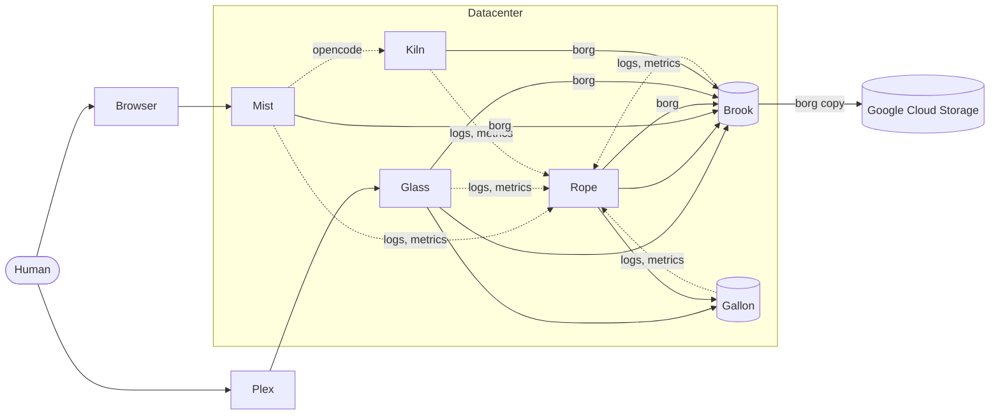

It has been a while since my [Postmortem & Homelab Updates](https://writing.natwelch.com/post/759) post, which was the sequel to [Homelab 2024](https://writing.natwelch.com/post/745). So I figured I would write up some of the changes.

The biggest change is [due to moving from NY](https://writing.natwelch.com/post/778). Because of that, none of it runs in my basement anymore. Instead, the servers now live in colocation at [24shells](https://24shells.net) in Newark, New Jersey.

It is still mostly the same shape, but I'm running a lot more random stuff. There is also a new machine (not pictured above).

## Platform

Every machine has a base set of infrastructure which serves as my base platform for operating.

For networking, [Tailscale](https://github.com/tailscale/tailscale) runs on every host. I don't use it much, but for a few use cases, it is great to have. The majority of my connections come through SSH, using Mist as a jump box.  I also run [fail2ban](https://github.com/fail2ban/fail2ban) on Mist for blocking all the bad scrapers.

For a very long time I had no monitoring of my stuff. Observability is my day job, why mess with it for fun? Because I am a sadist? Maybe. Anyways, [Grafana Alloy](https://github.com/grafana/alloy) runs on every host and ships logs and metrics to [Loki](https://github.com/grafana/loki) and [Prometheus](https://github.com/prometheus/prometheus) on Rope, with [Grafana](https://github.com/grafana/grafana) and [Alertmanager](https://github.com/prometheus/alertmanager) on top. I don't really use Grafana much, instead mostly relying on alerts and AI to debug.

For external monitoring, I use the free tier of [UptimeRobot](https://uptimerobot.com) which watches the public sites and endpoints.

For my backups, every host runs [Borg](https://github.com/borgbackup/borg) to Brook, and Brook copies the Borg repository to Google Cloud Storage daily.

Most of my services that need data use either [Postgres](https://github.com/postgres/postgres) or [Redis](https://github.com/redis/redis) on Rope.

Finally, the newest addition: A mail server ([docker-mailserver](https://github.com/docker-mailserver/docker-mailserver)) on Mist, plus [Parse DMARC](https://github.com/dmarcguardhq/parse-dmarc) for DMARC reports.

## Storage

Brook and Gallon are mostly just disk arrays. But Brook does run [Maestral](https://github.com/samschott/maestral) to keep a copy of my Dropbox account.

## Media (Rope)

Rope serves most of my media archive. You can think of it as the librarian to my storage boxes. It runs the following software:

- [RomM](https://github.com/rommapp/romm) for game ROMs.
- [slskd](https://github.com/slskd/slskd) for Soulseek.
- [spotify-to-plex](https://github.com/jjdenhertog/spotify-to-plex) to sync playlists into Plex.
- [GYB](https://github.com/GAM-team/got-your-back) to back up Gmail. I should move this to Brook.
- [harvestarr](https://github.com/icco/harvestarr) and [letterboxd-list-radarr](https://github.com/icco/letterboxd-list-radarr), two small tools for feeding the Servarr stack.
- [FlareSolverr](https://github.com/FlareSolverr/FlareSolverr) for Prowlarr. This doesn't really work anymore, I should take it down.

Plus all of the *arr software mentioned in previous posts.

## Websites and apps (Mist)

The following are open source apps I have built and currently run.

- Etu, a journaling app: [web](https://github.com/icco/etu-web) and [backend](https://github.com/icco/etu-backend) (plus sync and tag generation workers) at etu.timeclimbers.com.
- [art](https://github.com/icco/art) is a small app for auditing my email and my calendar.
- [artgrabber](https://github.com/icco/artgrabber) is a small discord bot for inspiring me.
- [cambridge](https://github.com/icco/cambridge), an analog style world clock for my house.
- [code](https://github.com/icco/code.natwelch.com), [images](https://github.com/icco/images), [videos](https://github.com/icco/videos), [linkbot](https://github.com/icco/linkbot), and [roderick](https://github.com/icco/roderick).
- [gotak](https://github.com/icco/gotak), [lilguys.love](https://github.com/icco/lilguys.love), and [robot.villas](https://github.com/icco/robot.villas).
- go.icco.me, which I wrote about in [Hosted Go Urls](https://writing.natwelch.com/post/780) ([config](https://github.com/icco/icco.me/blob/main/mist/docker-compose.yml)).
- [acntng](https://github.com/icco/acntng), my personal accounting tool.
- A Borg status page and a devcloud.org redirect, both just compose entries in [icco/icco.me](https://github.com/icco/icco.me/blob/main/mist/docker-compose.yml).

## AI (Kiln)

Kiln is a new box with a Tesla P40. By "new", I mean new to me. Like almost everything else I run, it's built using used and recycled parts I get from Craigslist, eBay, Facebook Marketplace, friends, etc. Most computer stuff, especially datacenter equipment, is sold and gotten rid of while it is still in great shape. So I'm happy to refurbish or replace a few pieces to get something greatly discounted. 

Anyways, Kiln runs [LightLLM](https://github.com/BerriAI/litellm), [Ollama](https://github.com/ollama/ollama), [OpenCode](https://github.com/anomalyco/opencode) and [OpenChamber](https://github.com/openchamber/openchamber) (packaged as [opencode-server](https://github.com/icco/opencode-server)). It gets the same Alloy, Borg, and cron setup as the other hosts, plus [nvidia_gpu_exporter](https://github.com/utkuozdemir/nvidia_gpu_exporter) so I can watch the P40 in Grafana. I use a mixture of open source models, Claude, Gemini and Jev to serve opencode and any of my sites that might need a little bit of AI.

I hope you found that useful. Or at least interesting.

/Nat

#homelab #infrastructure
